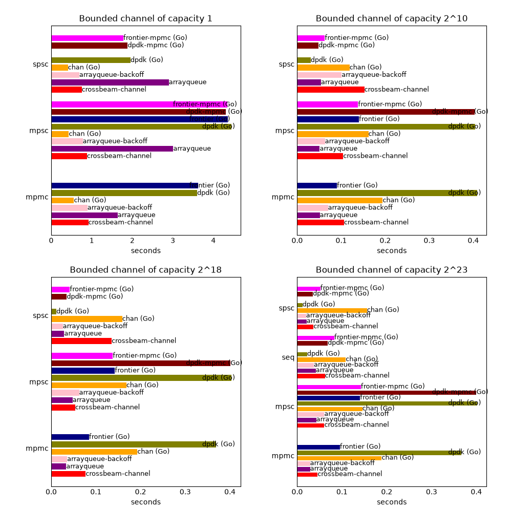

# Crossbeam comparison results

These results come from two campaigns that meet the [decision rule](README.md#decision-rule).
The [README](README.md) defines rows, columns, cells, and campaigns, and it describes the method
and the [caveats](README.md#caveats). Read the caveats before you compare a Go column with a Rust
column.

## Campaigns

| | Campaign A | Campaign B |
|---|---|---|
| Results directory | `20261102-205159-1402129` | `20261102-211155-1435437` |
| Date | 2026-11-02 | 2026-11-02 |
| Seed | 1000 | 2000 |
| Rounds | 20 | 20 |
| Time for the rounds | 1157 s | 1157 s |
| Load average before | 0.30 0.20 0.36 | 3.84 5.11 4.03 |
| Load average after | 5.99 5.65 4.16 | 4.59 5.00 4.83 |
| Status | `complete` | `complete` |

Campaign B started about 30 s after campaign A finished. Both campaigns ran at commit `dbc8778`
with a clean tree, with a 120 s timeout and 5,000,000 messages for each invocation. Each campaign
kept all 1820 samples, 20 for each of the 91 cells. Neither campaign recorded a finding, an
incomplete cell, or an excluded cell.

Both `state.txt` files record the same machine and toolchains:

- CPU: AMD Ryzen 7 5800X 8-Core Processor, pinned to CPUs 0, 2, 4, 6, 8, 10, 12, and 14.
- Kernel: Linux 6.18.54.1-microsoft-standard-WSL2, so the machine runs Linux under WSL2.
  `state.txt` does not record the kernel. This line comes from the machine after the campaigns.
- Transparent huge pages: `enabled` is `madvise` and `defrag` is `madvise`.
- Go: go1.27.3 linux/amd64, `GOAMD64=v1`.
- Rust: rustc 1.99.1 (58cf8f9c3 2026-10-13) with LLVM 23.1.1, and cargo 1.99.1
  (5f94df478 2026-08-27).
- benchstat: `golang.org/x/perf` v0.0.0-20261009192801-be2c69fb417e.
- Crates: crossbeam 0.8.5, crossbeam-channel 0.5.17, crossbeam-deque 0.8.8,
  crossbeam-epoch 0.9.21, crossbeam-queue 0.3.14, and crossbeam-utils 0.8.23.
- `runtime.sched` offset: 32 in `gochan` and 96 in `ring`.

The results directories are under `~/crossbeam-compare/` on the development machine and are not
in the repository.

## Medians

Each cell shows the median for campaign A, then campaign B, in ns per message. A median in ns per
message is the median from `median.txt` in seconds, times 10^9, divided by 5,000,000. An empty
cell is a cell that no program runs. The `bounded1` rows mostly measure how a worker waits for
the other side (see [Caveats](README.md#caveats)).

To compare MPMC queues in every topology, read the `dpdk-mpmc` and `frontier-mpmc` columns for
`seq`, `spsc`, and `mpsc`, and the `dpdk` and `frontier` columns for `mpmc`. The README explains
this in [Reading the MPMC columns](README.md#reading-the-mpmc-columns).

### `mpmc`: four senders and four receivers

| Column | `bounded1` | `bounded1024` | `bounded2p18` | `bounded2p23` |
|---|---:|---:|---:|---:|
| Rust crossbeam-channel | 183.3 / 182.4 | 21.3 / 19.6 | 15.4 / 14.9 | 9.1 / 9.1 |
| Rust arrayqueue | 327.9 / 326.2 | 10.3 / 10.7 | 6.7 / 6.0 | 5.8 / 6.0 |
| Rust arrayqueue-backoff | 178.5 / 178.5 | 14.0 / 14.9 | 7.1 / 7.2 | 5.7 / 5.9 |
| Go chan | 112.3 / 112.8 | 38.8 / 39.0 | 38.6 / 38.5 | 37.7 / 37.6 |
| Go dpdk | 719.9 / 718.0 | 81.9 / 82.1 | 73.8 / 73.7 | 73.2 / 73.4 |
| Go frontier | 724.5 / 727.0 | 18.0 / 17.9 | 16.9 / 16.8 | 19.1 / 19.1 |

### `mpsc`: four senders and one receiver

| Column | `bounded1` | `bounded1024` | `bounded2p18` | `bounded2p23` |
|---|---:|---:|---:|---:|
| Rust crossbeam-channel | 176.2 / 174.0 | 20.9 / 20.7 | 10.8 / 9.7 | 12.1 / 13.0 |
| Rust arrayqueue | 602.0 / 601.0 | 10.2 / 10.2 | 9.6 / 9.5 | 8.5 / 9.6 |
| Rust arrayqueue-backoff | 155.4 / 156.0 | 12.6 / 12.6 | 12.5 / 13.1 | 12.1 / 11.7 |
| Go chan | 87.0 / 86.3 | 32.3 / 32.1 | 33.6 / 33.6 | 29.1 / 29.1 |
| Go dpdk | 888.8 / 888.6 | 80.8 / 80.9 | 80.7 / 80.5 | 80.5 / 80.3 |
| Go frontier | 870.8 / 872.3 | 28.0 / 28.0 | 28.5 / 28.2 | 28.1 / 28.1 |
| Go dpdk-mpmc | 861.4 / 861.7 | 80.5 / 80.6 | 80.3 / 80.3 | 79.9 / 80.0 |
| Go frontier-mpmc | 867.7 / 864.8 | 27.7 / 27.7 | 27.6 / 27.5 | 28.4 / 28.4 |

### `spsc`: one sender and one receiver

| Column | `bounded1` | `bounded1024` | `bounded2p18` | `bounded2p23` |
|---|---:|---:|---:|---:|
| Rust crossbeam-channel | 150.5 / 150.7 | 30.5 / 29.4 | 27.1 / 27.1 | 7.3 / 7.2 |
| Rust arrayqueue | 580.2 / 582.0 | 10.8 / 11.1 | 5.8 / 5.7 | 4.2 / 4.2 |
| Rust arrayqueue-backoff | 138.4 / 139.2 | 20.2 / 20.1 | 5.2 / 5.4 | 4.0 / 4.0 |
| Go chan | 82.6 / 83.0 | 23.8 / 23.8 | 31.8 / 31.5 | 31.2 / 31.5 |
| Go dpdk | 390.9 / 393.5 | 6.1 / 6.1 | 2.3 / 2.3 | 2.3 / 2.3 |
| Go dpdk-mpmc | 377.3 / 378.4 | 9.7 / 9.8 | 7.0 / 7.0 | 7.0 / 6.9 |
| Go frontier-mpmc | 355.7 / 357.9 | 12.6 / 12.6 | 8.3 / 8.3 | 10.3 / 10.4 |

### `seq`: one thread sends every message, then receives them

| Column | `bounded2p23` |
|---|---:|
| Rust crossbeam-channel | 12.4 / 12.3 |
| Rust arrayqueue | 8.3 / 8.3 |
| Rust arrayqueue-backoff | 7.4 / 7.5 |
| Go chan | 21.7 / 21.6 |
| Go dpdk | 4.4 / 4.5 |
| Go dpdk-mpmc | 13.7 / 13.6 |
| Go frontier-mpmc | 16.6 / 16.6 |

The plot shows campaign A's `median.txt`, in seconds for all 5,000,000 messages.

## Repeatability

For each cell, the difference between the two campaigns is the absolute difference of the two
medians, as a percentage of the smaller one. This table gives the largest difference in each
column, and the widest 95% confidence interval that `benchstat` printed for the column in
`summary-Go-chan.txt`, as ± percent of the median.

| Column | Largest A to B difference | Widest interval, A | Widest interval, B |
|---|---:|---:|---:|
| Rust crossbeam-channel | 11.2% (`bounded2p18_mpsc`) | ±21% | ±24% |
| Rust arrayqueue | 13.3% (`bounded2p23_mpsc`) | ±13% | ±8% |
| Rust arrayqueue-backoff | 6.4% (`bounded1024_mpmc`) | ±22% | ±29% |
| Go chan | 1.0% (`bounded2p23_spsc`) | ±1% | ±1% |
| Go dpdk | 0.8% (`bounded2p18_spsc`) | ±3% | ±3% |
| Go frontier | 1.0% (`bounded2p18_mpsc`) | ±4% | ±5% |
| Go dpdk-mpmc | 0.8% (`bounded2p23_spsc`) | ±6% | ±3% |
| Go frontier-mpmc | 0.6% (`bounded1_spsc`) | ±2% | ±2% |

Every Go median repeated within 1.0%. The Rust medians differed by up to 13.3%. One hypothesis,
not tested, is that the Rust spread comes from heap addresses that change in every process, as
the [memory layout caveat](README.md#caveats) describes. Go heap addresses stay the same between
runs of a binary.

## Differences that pass the decision rule

Each campaign tests 238 pairs. A pair is two cells in the same row where at least one cell is a Go
column, because each `benchstat` table compares one Go column with every other column. Campaign A
marked 236 pairs significant and campaign B marked 235. The two campaigns agree on 234 pairs,
which are listed in [results-significant.txt](results-significant.txt) in the format that the
README describes for `significant.txt`.

Four pairs do not pass:

- `bounded2p18_mpmc`, `Go frontier` and `Rust crossbeam-channel`: significant in neither
  campaign.
- `bounded2p23_mpsc`, `Go frontier` and `Go frontier-mpmc`: significant only in B.
- `bounded1024_mpsc`, `Go frontier` and `Go frontier-mpmc`: significant only in A.
- `bounded2p18_mpsc`, `Go dpdk` and `Go dpdk-mpmc`: significant only in A.

Nearly every pair passes, because 20 samples give the Go columns intervals of a few percent. A
pair that passes can still differ by very little, so read the size of each difference from the
medians. For each passing pair, the size here is the slower cell's median over the faster cell's
median, minus 1, with each median the mean of A and B. Of the 234 pairs, 218 differ by 10% or
more, 2 differ by 5% to 10%, and 14 differ by less than 5%. Thirteen of those 14 compare two Go
ring columns, or a ring column with Go chan, at `mpsc` or at `bounded1`. The fourteenth is
`Go dpdk-mpmc` against `Rust crossbeam-channel` at `bounded2p23_spsc`, with a difference of 4.0%.

## Findings

These findings state what the medians and the decision rule show. Each explanation of a cause is
labeled as a hypothesis, and none was tested.

### MPMC

At `mpmc` with capacity 1024 or more, `Go frontier` took 16.8 to 19.1 ns per message, and
`Go dpdk` took 73.2 to 82.1 ns. `Go frontier` was faster than `Go dpdk` and Go chan in all three
rows. It was slower than `Rust arrayqueue` and `Rust arrayqueue-backoff` in all three rows. Against
`Rust crossbeam-channel`, `Go frontier` was faster at `bounded1024_mpmc`, the difference did not
pass at `bounded2p18_mpmc`, and crossbeam-channel was faster at `bounded2p23_mpmc`.

At `bounded1_mpmc`, Go chan was the fastest column, at about 112 ns. `Go dpdk` and `Go frontier`
took about 720 ns, slower than every Rust column.

The repository's own MPMC report, [mpmc.md](../ring/mpmc.md), uses a different harness. At 1024
slots with single-element calls, it measured 79.9 ns for `ring-single` (`dpdk.MPMCQueue`) and
30.8 ns for `frontier-single` (`frontier.MPMCQueue`). Here `Go dpdk` took 81.9 ns at
`bounded1024_mpmc`, and `Go frontier` took 18.0 ns. This report did not examine why the frontier
numbers differ between the two harnesses.

One hypothesis, not tested, is that `Go dpdk` is slower than `Go frontier` because a `dpdk`
producer waits for earlier producers before it publishes its slot, and a `frontier` producer
does not.

### Other topologies

- **`mpsc`.** With capacity 1024 or more, `Go frontier` and `Go frontier-mpmc` took 27.5 to
  28.5 ns per message, and `Go dpdk` and `Go dpdk-mpmc` took 79.9 to 80.9 ns. Go chan took 29.1
  to 33.6 ns. Every Rust column took 8.5 to 20.9 ns, faster than every Go column. At
  `bounded1_mpsc`, Go chan took about 87 ns, and the four ring columns took 861 to 889 ns.
- **`spsc`.** With capacity 1024 or more, `Go dpdk`, which uses `SPSCQueue`, was the fastest
  column, at 6.1 ns for `bounded1024` and 2.3 ns for the two larger capacities. The MPMC columns
  `Go dpdk-mpmc` and `Go frontier-mpmc` took 6.9 to 12.6 ns. At `bounded1_spsc`, Go chan was the
  fastest column, at about 83 ns.
- **`seq`.** `Go dpdk` was the fastest column, at 4.4 to 4.5 ns. `Go dpdk-mpmc` took 13.6 to
  13.7 ns and `Go frontier-mpmc` 16.6 ns, slower than the three Rust columns and faster than Go
  chan at 21.6 to 21.7 ns.

In every `bounded1` row, Go chan was faster than every other column in both campaigns. The README
says that these rows mostly measure the waiting mechanism.
